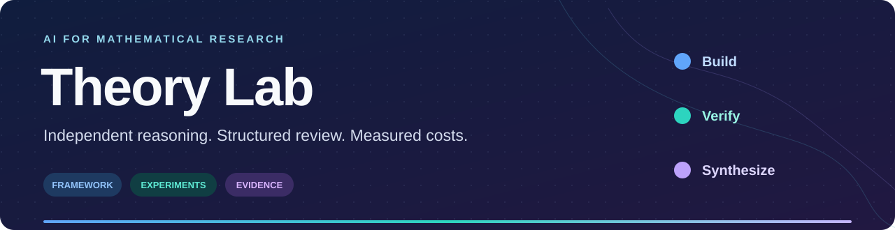
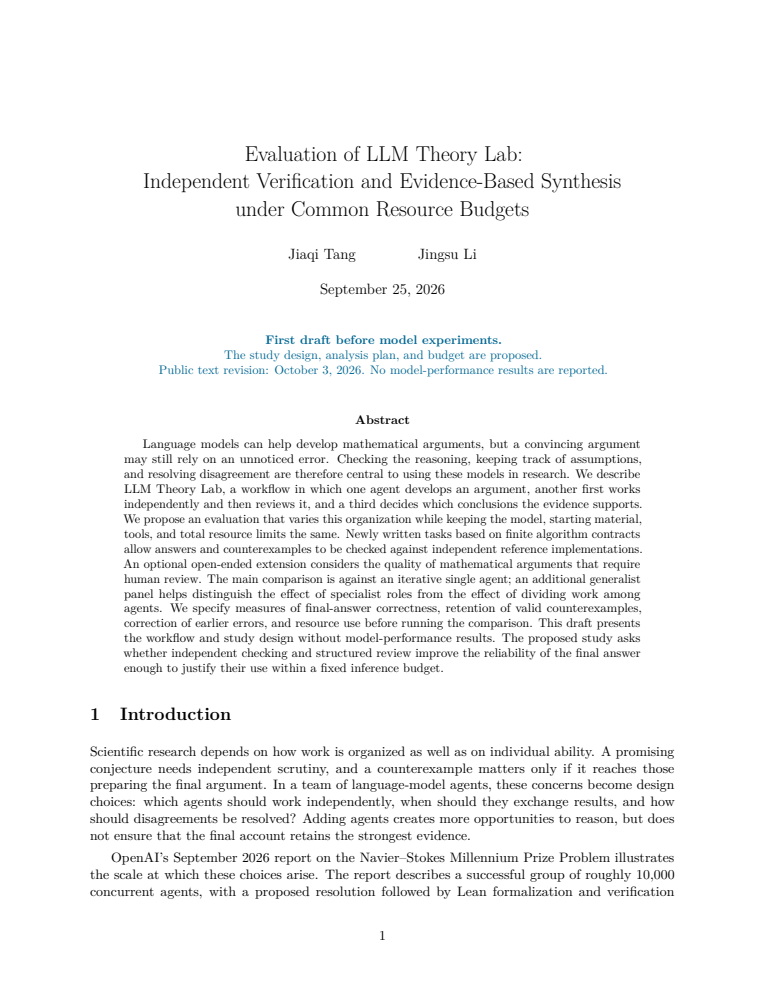
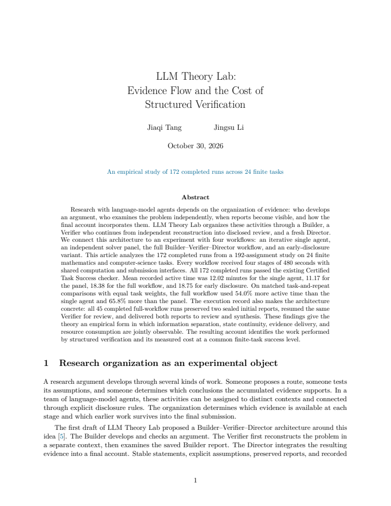
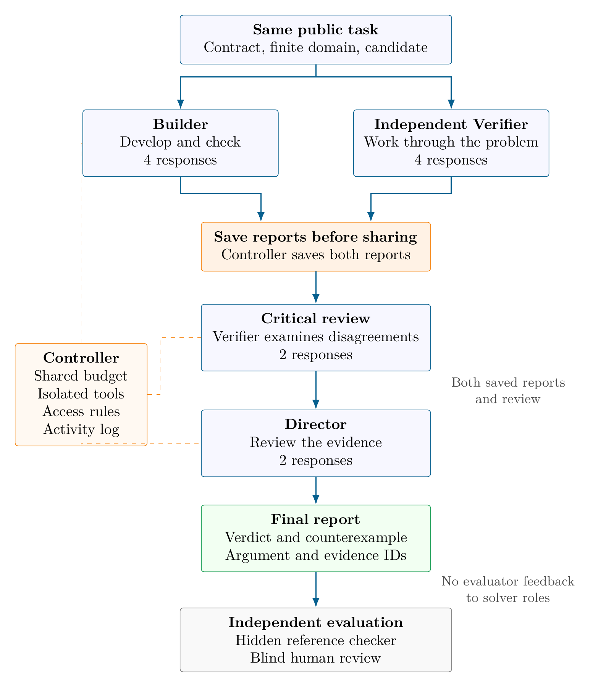
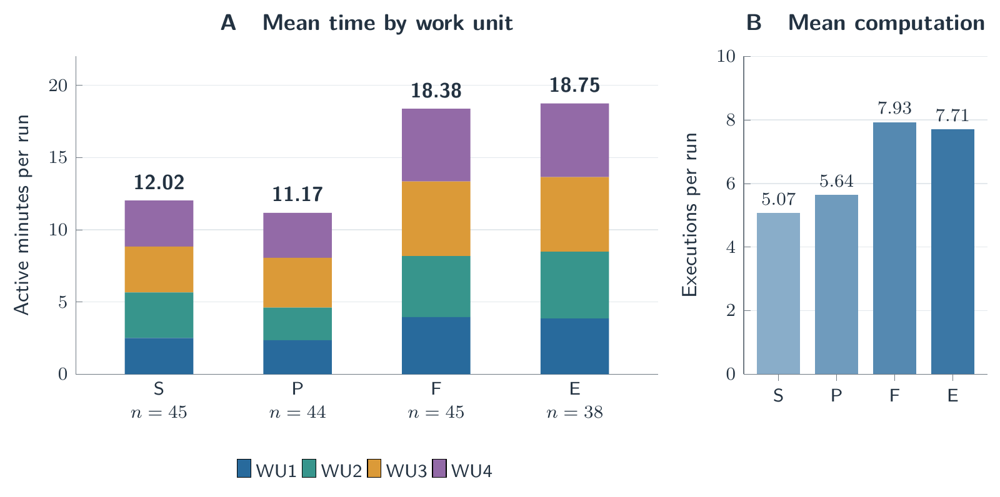
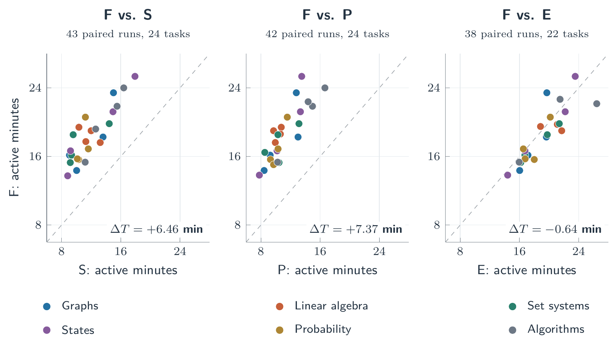

<p align="center">
  
</p>

# Theory Lab: Multi-Agent AI for Mathematical Research

Theory Lab organizes mathematical research around a **Builder**, an **independent Verifier**, and a **Director**. We study how their information, continuing context, and exchange of evidence shape the work—and measure the cost of that organization.

<p align="center">
  <a href="docs/llm_theory_lab_first_draft.pdf"></a>
  <a href="docs/llm_theory_lab_empirical_article.pdf"></a>
  <a href="#use-the-workflow"></a>
</p>

<p align="center">
  <a href="#two-papers">Papers</a> ·
  <a href="#method-independent-preparation-then-review">Method</a> ·
  <a href="#experiment-four-workflows-under-common-limits">Experiment</a> ·
  <a href="#results-the-cost-of-structured-verification">Results</a> ·
  <a href="#what-we-learned">Conclusions</a>
</p>

<table>
  <tr>
    <td align="center" width="25%"><strong>24</strong><br>finite mathematical tasks</td>
    <td align="center" width="25%"><strong>6</strong><br>task families</td>
    <td align="center" width="25%"><strong>4</strong><br>compared workflows</td>
    <td align="center" width="25%"><strong>172</strong><br>completed runs analyzed</td>
  </tr>
</table>

**Latest finding:** all 172 completed runs passed the finite-task checker. In matched comparisons, the full workflow used **54.0% more active time than a continuing single agent** and **65.8% more than an independent panel**. Its execution record shows how independently prepared reports reached review and synthesis.

## Two papers

<table>
  <tr>
    <th width="50%">01 · Theoretical framework</th>
    <th width="50%">02 · Experimental design &amp; results</th>
  </tr>
  <tr>
    <td align="center" valign="top">
      <a href="docs/llm_theory_lab_first_draft.pdf"></a>
      <p><strong>Evaluation of LLM Theory Lab</strong><br>Independent verification and evidence-based synthesis</p>
      <p>The original architecture, role protocols, correction–retention framework, and proposed evaluation.</p>
      <p><strong>First draft: September 25, 2026</strong><br>Public text revision: October 3, 2026</p>
      <a href="docs/llm_theory_lab_first_draft.pdf"><strong>Read the framework →</strong></a>
    </td>
    <td align="center" valign="top">
      <a href="docs/llm_theory_lab_empirical_article.pdf"></a>
      <p><strong>Evidence Flow and the Cost of Structured Verification</strong><br>LLM Theory Lab</p>
      <p>The implemented comparison, completed-run results, and observed path of evidence through the agents.</p>
      <p><strong>October 30, 2026</strong><br>172 completed runs · 24 finite tasks</p>
      <a href="docs/llm_theory_lab_empirical_article.pdf"><strong>Read the empirical study →</strong></a>
    </td>
  </tr>
</table>

## Method: independent preparation, then review

A plausible argument needs someone to test its assumptions, locate an invalid step, and check whether a counterexample applies. Theory Lab assigns that work to separate roles while preserving the exact statements and evidence they exchange.

| Role | Research responsibility |
| :--- | :--- |
| 🔵 **Builder** | Develop the argument, state its assumptions, and test how it might fail. |
| 🟢 **Verifier** | Work through the problem independently, save that account, then continue into a critical review of the Builder's report. |
| 🟣 **Director** | Read the reports and review, resolve disagreements through evidence, and produce the final account. |

<p align="center">
  
</p>

*Original framework figure, including the first draft's response allocation. The empirical study implements the role sequence using the four timed stages below.*

The method combines **independent preparation**, **continuity within a role**, and **explicit report disclosure**. Saving the initial reports lets us distinguish what each investigator found independently from what it learned during review. Versioned claims preserve assumptions, supporting arguments, corrections, and failed attempts.

[Architecture and operating rules →](ARCHITECTURE.md)

## Experiment: four workflows under common limits

The study assigns **24 tasks × 4 workflows × 2 repeats = 192 assignments**. The empirical paper analyzes **172 completed attempts** using completion status and the batch's existing chronological attempt-selection rule. CTS outcomes are then read from the saved grading results. Twenty assignments fall outside this completed-run analysis.

| Condition | Stage 1 | Stage 2 | Stage 3 | Stage 4 |
| :--- | :--- | :--- | :--- | :--- |
| **S · Single agent** | Solver | Same solver | Same solver | Same solver |
| **P · Independent panel** | Solver A | Independent Solver B | Integrator | Same Integrator |
| **F · Full Theory Lab** | Builder | Independent Verifier | Same Verifier reviews both saved reports | Fresh Director |
| **E · Early disclosure** | Builder | Verifier sees Builder report when available | Same Verifier reviews | Fresh Director |

- **Tasks:** graphs, linear algebra, set systems, states and invariants, probability, and algorithm guarantees. Twelve claims are true and twelve false; starting material includes useful partial work and plausible errors.
- **Shared limits:** four stages of 480 seconds, up to six computation executions per stage and 24 per run. Repeated roles keep their session; independent roles and repeats start fresh.
- **Model request:** `gpt-6-astra` with `ultra` reasoning effort, held common across conditions.
- **Outcome:** Certified Task Success (**CTS**) checks the fixed goal, the required finite evidence, and preservation of the task's scope.
- **Cost:** recorded active time sums the four solver-stage intervals, including model and tool waits. Allocation, handoff, sealing, and cleanup are measured outside this quantity.
- **Comparison:** match the same task and repeat, average available repeats within each task, then give each matched task equal weight.

## Results: the cost of structured verification

### 1 · Same completed-run success, different resource use

| Workflow | Completed runs | CTS passes | Mean active time | Mean computation executions |
| :--- | ---: | ---: | ---: | ---: |
| **S · Single agent** | 45 | 45/45 | 12.02 min | 5.07 |
| **P · Independent panel** | 44 | 44/44 | 11.17 min | 5.64 |
| **F · Full Theory Lab** | 45 | 45/45 | 18.38 min | 7.93 |
| **E · Early disclosure** | 38 | 38/38 | 18.75 min | 7.71 |



**Structured review has a measurable cost.** F and E use about 18–19 active minutes per completed run. The stage breakdown shows how that work is distributed across construction, verification, review, and synthesis. WU1–WU4 denote the four stages in the design table.

### 2 · The cost difference persists on matched tasks



Each point represents a task after averaging its available matched repeats. The dashed line marks equal active time; colors identify the six task families.

| Matched comparison | Run pairs / tasks | F active-time difference | Relative difference |
| :--- | ---: | ---: | ---: |
| **F vs. S** | 43 / 24 | +6.46 min | +54.0% |
| **F vs. P** | 42 / 24 | +7.37 min | +65.8% |
| **F vs. E** | 38 / 22 | −0.64 min | −3.4% |

F takes more active time than S and P on **all 24 matched task averages**. F and E are much closer: delayed disclosure averages about 39 seconds less active time in the matched completed runs.

[Condition summaries](data/condition_summary.csv) · [Matched task means](data/paired_task_means.csv) · [Data definitions](data/README.md)

## What we learned

1. **For these completed finite tasks, simpler workflows reached the same certified outcome with less active time.** Final CTS is saturated across all four conditions; the measured distinction is cost and work organization.
2. **The intended evidence path is observable.** All 45 completed F runs preserved both initial reports, continued the same Verifier into review, and delivered both reports to review and synthesis. In 44 runs, the Director also received a completed audit; one audit timed out before a successful final submission.
3. **Disclosure timing is a concrete experimental variable.** F preserves an independent first account; E exposes the Builder's report earlier when available, as observed in 37 of 38 completed E runs. Their similar costs make this a useful comparison for studying what independent preparation contributes.

The next question is the value of the intermediate work: which errors are corrected, which correct findings survive synthesis, and when the added review effort pays off. Preserved reports and disclosure records provide the objects needed to study those questions.

## Use the workflow

Start with a bounded research task and the same initial material for the Builder and Verifier. Keep their first attempts separate, save both reports, then share them for review. Let the Director trace its conclusions to the arguments and objections.

| Resource | What it provides |
| :--- | :--- |
| [Builder prompt](protocols/BUILDER.md) | Construction, assumptions, counterexamples, and reporting |
| [Verifier prompt](protocols/VERIFIER.md) | Independent preparation followed by critical review |
| [Director prompt](protocols/DIRECTOR.md) | Evidence-based synthesis and decisions |
| [Claim records](protocols/STATUS_POLICY.md) | Statement versions, evidence, and review status |
| [Architecture guide](ARCHITECTURE.md) | Information flow, role permissions, and operating requirements |

The public release includes papers, reusable protocols, and the figure summary data. Implementations need to enforce the access rules described in the architecture guide; an executable experiment runner is not included here.

## Research context

<details>
<summary><strong>Independent development, Cogentic v1, and evaluating an architecture</strong></summary>

We wrote the first Theory Lab draft on **September 25, 2026**. [Cogentic v1](https://arxiv.org/abs/2609.40324v1) appeared on **September 30, 2026**. Theory Lab was developed independently. These dates describe our draft and their public release; Google's internal development timeline is unknown to us.

Cogentic uses related ideas: coordinated proof attempts, adversarial verification, and a record of checked intermediate results. It reports expert-checked results on five research problems. Our October 3 reading raised three questions about reuse and evaluation:

- [Appendix A](https://arxiv.org/html/2609.40324v1) provides task inputs, while complete prompts for the orchestrator, provers, and verifiers would help readers reconstruct the workflow.
- As of **October 3, 2026**, we found no links to a complete implementation, full role prompts, run configurations, or execution logs in the v1 paper or [official project page](https://sites.google.com/view/cogentic).
- The v1 paper does not report simpler-workflow comparisons under matched resource budgets or component ablations. These comparisons would help identify the contribution of the architecture.

Theory Lab makes its role instructions available and follows the original evaluation proposal with a controlled workflow comparison. The October 30 paper reports the observed costs and evidence paths, including the common CTS level across completed runs. We welcome stronger baselines, better tasks, and independent evaluations of when structured verification is useful.

</details>

## Build on this work

Use and adapt the protocols, examine the reported comparisons, or develop a better evaluation. Please cite the repository or the relevant manuscript and identify the version you used. Citation metadata is available in [CITATION.cff](CITATION.cff).

```bibtex
@misc{tang2026theorylab,
  author = {Tang, Jiaqi and Li, Jingsu},
  title = {Theory Lab: Multi-Agent AI for Mathematical Research},
  year = {2026},
  howpublished = {GitHub repository},
  url = {https://github.com/TanhJK728/AI4MATH-Multi-Agent-System}
}

@techreport{tang2026evidenceflow,
  author = {Tang, Jiaqi and Li, Jingsu},
  title = {LLM Theory Lab: Evidence Flow and the Cost of Structured Verification},
  year = {2026},
  month = oct,
  url = {https://github.com/TanhJK728/AI4MATH-Multi-Agent-System/blob/main/docs/llm_theory_lab_empirical_article.pdf}
}
```
